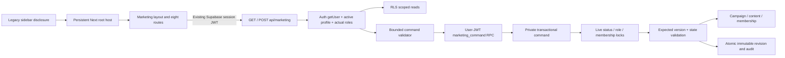

# Marketing architecture — Phase 1

The fixed user specification is implemented as an additive module. It does not replace the legacy dashboard, change the mentor model, or add a deployed LLM/tool runner.

`app/WorkspaceHost.tsx` loads the legacy application only after it is visited. Once mounted, it keeps the same iframe hidden during client-side Marketing navigation. Returning through a Next Link restores the existing iframe and `go()` applies the selected legacy route with its existing dirty-form guard. A direct Marketing deep link does not boot the large legacy application.

`app/marketing/layout.tsx` retains the provider, disclosure and selected Campaign while child routes change. Stored Campaign IDs are checked against the current RLS-filtered data before use. Draft caches are scoped to profile UUID. A stale edit does not silently acquire a newer server version.

## Data boundaries

Public tables: `marketing_teams`, `marketing_team_memberships`, `marketing_campaigns`, `marketing_content_items`, `marketing_revisions`, `marketing_audit_logs` and a reserved `marketing_approval_snapshots` table. All have RLS and authenticated SELECT only. There are no authenticated direct inserts, updates or deletes. `service_role` is not granted access to these new tables/functions by this migration.

The public invoker RPC forwards into `marketing_private.command`. The private definer uses an empty search path, explicit object names, `auth.uid()`, fresh database status/roles, row locks and explicit team scope. Its command vocabulary is finite; it cannot publish, approve, read arbitrary URLs, execute SQL, send messages, call MCP, delete accounts or modify legacy entities. The private schema is not a PostgREST exposed schema; direct calls to the exposed invoker have the same checks.

Mutations lock the actor profile/roles and relevant membership through commit. Campaign/content writes take campaign-before-content locks and compare `expected_version`. Each successful write and revision/audit append is atomic. Creator/team/campaign identity and official activated KPI snapshot are immutable. Sensitive histories reject UPDATE/DELETE, including accidental owner DML. The reserved approval table has `creator_id != approver_id`; no Phase 1 command inserts an approval.

Dates are persisted as UTC timestamptz and rendered in Asia/Ho_Chi_Minh. Production deadline, review deadline and proposed publication time are distinct. Proposed time is explicitly an in-app plan, not a remote schedule receipt.

## State machines

Campaign: draft → pending_activation → active → completed → archived, with manager pause/resume and team emergency hold. Representative cannot activate. Pending plans are frozen. On activation, exact KPI targets are copied into an immutable official snapshot. Active plan/mix edits may continue with unchanged KPI targets; official KPI revisions await a later explicit approval workflow. Resume only changes Campaign state; it never schedules or republishes content.

Content production and publishing are separate. Phase 1 can create/edit drafts, submit review and request changes. A content edit invalidates the previous review state and creates a new version. There is no command reaching approved/scheduled/published. Future Phase 4 must add exact payload hashes, separate eligible human approver, preflight, durable outbox and remote receipts together.

## Reads and reliability

Five RLS-filtered read groups load concurrently through the user-JWT client. Each group is range-paged below Supabase's default API row limit, with exact count and stable ordering. A workspace over the explicit Phase 1 safety limits returns an actionable capacity error instead of silently truncating counts/calendar. Current limits: 100 teams, 1,000 memberships, 500 campaigns, 2,000 content items and 5,000 revisions. Large-scale filtered pagination is deferred.

GET/POST use private/no-store responses. POST caps the actual stream at 256 KB, rejects extra command fields, validates explicit timezone, exact Content Mix, bounded KPIs and timestamps, and repeats checks in SQL. Unexpected database messages are not returned to browsers. Conflicts are 409, changed permission 403, missing migration 503.

## External services and rollback

Meta, Drive, LLM research, media editor and render worker are not configured in Phase 1. No background scheduler or cron is registered. The API reports real unconfigured states, not inferred account health. Go-live must remain disabled until the later publishing gateway and verified Admin setup exist.

Roll back application code by reverting the Marketing commit. The migration is additive and touches no legacy tables or policies. Leave Marketing data intact and revoke the RPC execute grant if disabling access; do not drop tables/history as a routine rollback. Deployment/migration steps are in `README.md` in this directory.
